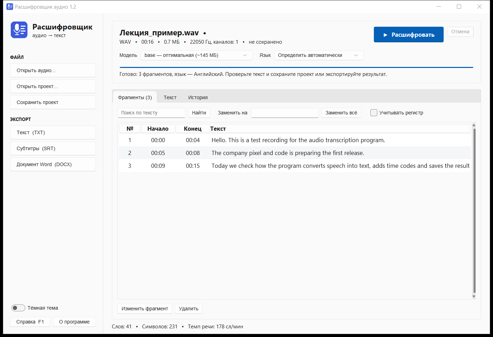

# Расшифровщик аудио

Учебная практика «Пиксель и Код» (36 часов), тема №12 «Расшифровщик аудио». Работа в паре.

Программа для Windows превращает аудиозапись в текст с таймкодами. Распознавание делает готовая модель
**Whisper** (библиотека faster-whisper) прямо на компьютере, запись никуда не отправляется. Результат можно
исправить и сохранить в TXT, SRT (субтитры) или Word.



## Функции (7)

1. **Открытие аудиофайла с проверкой**: WAV, MP3, M4A, OGG, FLAC и др. Показывает формат, длительность и размер; отклоняет пустые, повреждённые и неподходящие файлы.
2. **Расшифровка речи**: выбор модели (tiny / base / small) и языка (авто / русский / английский / украинский), шкала прогресса, отмена.
3. **Таймкоды**: таблица фрагментов со временем, переключатель «Показывать таймкоды».
4. **Редактирование**: правка фрагмента двойным щелчком, удаление фрагментов.
5. **Поиск и замена**: подсветка найденного, «Заменить всё».
6. **Экспорт**: TXT, SRT, DOCX.
7. **Проекты и история**: сохранить работу и продолжить позже; список прошлых расшифровок.

## Установка и запуск

Нужны Windows 10/11 и Python 3.10 или новее. При первой расшифровке нужен интернет: модель скачивается один раз.

1. `install.bat` — установить библиотеки (один раз).
2. `run.bat` — запустить программу.

Вручную:

```bash
pip install -r requirements.txt
python main.py
```

## Готовая программа (exe)

Скачайте `Расшифровщик аудио 1.2.zip`, распакуйте и запустите exe. Python не нужен. Файл `Расшифровщик аудио.exe` и папка `models` должны лежать рядом. В `models` уже лежит модель base, поэтому интернет не нужен. Первый запуск exe занимает 10–20 секунд: программа распаковывается.

Собрать exe самому: `build.bat` (нужны `pip install -r requirements.txt pyinstaller pillow`). Результат появится в папке `dist`.

## Тесты

```bash
python -m unittest discover -s tests -t .
```

```bash
python tools/gui_check.py
```

- `tests/` — 39 автотестов логики и распознавания.
- `tools/gui_check.py` — 30 сценарных проверок окна программы.
- 17 ручных тест-кейсов и журнал дефектов — в `docs/3_Тестирование.docx`.

Для скриптов из `tools/` (скриншоты, документы) нужен Pillow: `pip install -r requirements-dev.txt`.

## Структура

```
main.py               запуск программы
app/gui.py            окно (Tkinter)
app/transcriber.py    распознавание речи (faster-whisper)
app/audio_utils.py    проверка аудиофайла
app/exporter.py       экспорт TXT/SRT/DOCX, файлы проектов
app/text_tools.py     поиск, замена, статистика
app/history.py        история расшифровок
app/models.py         фрагмент, проект, формат времени
tests/                автотесты
tools/                проверка окна, скриншоты, генерация документов
samples/              тестовая запись и файлы для проверки ошибок
docs/                 карточка проекта, руководство, тестирование, скриншоты
```

## Документы

- [Карточка проекта (день 1)](docs/1_Карточка_проекта.docx): проблема, аналоги, требования, эскиз.
- [Руководство пользователя](docs/2_Руководство_пользователя.docx).
- [Журнал тестирования](docs/3_Тестирование.docx): 17 тест-кейсов, дефекты, версия 1.1.
- [История версий](CHANGELOG.md).

## Команда

| Участник | Роль | Задачи |
|---|---|---|
| [ФИО участника 1] | Логика, тестирование | transcriber.py, audio_utils.py, exporter.py, автотесты, журнал тестирования |
| [ФИО участника 2] | Интерфейс, документация | gui.py, text_tools.py, history.py, эскиз, руководство, презентация |
